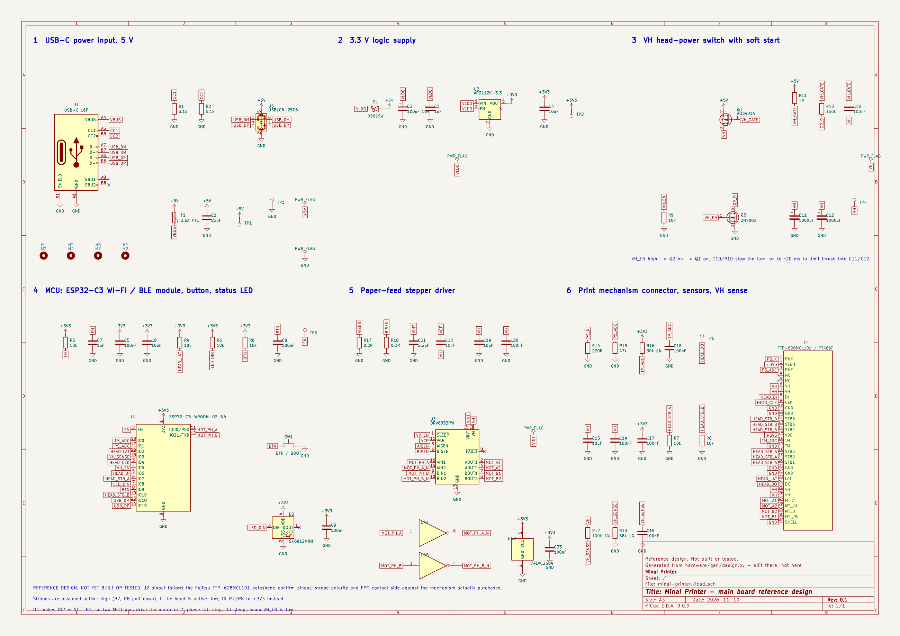
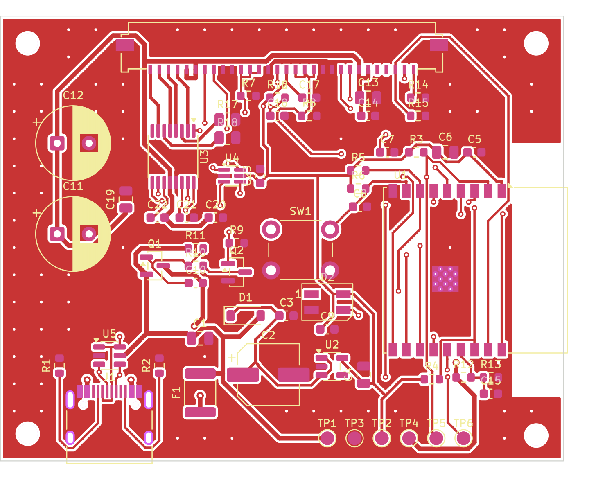
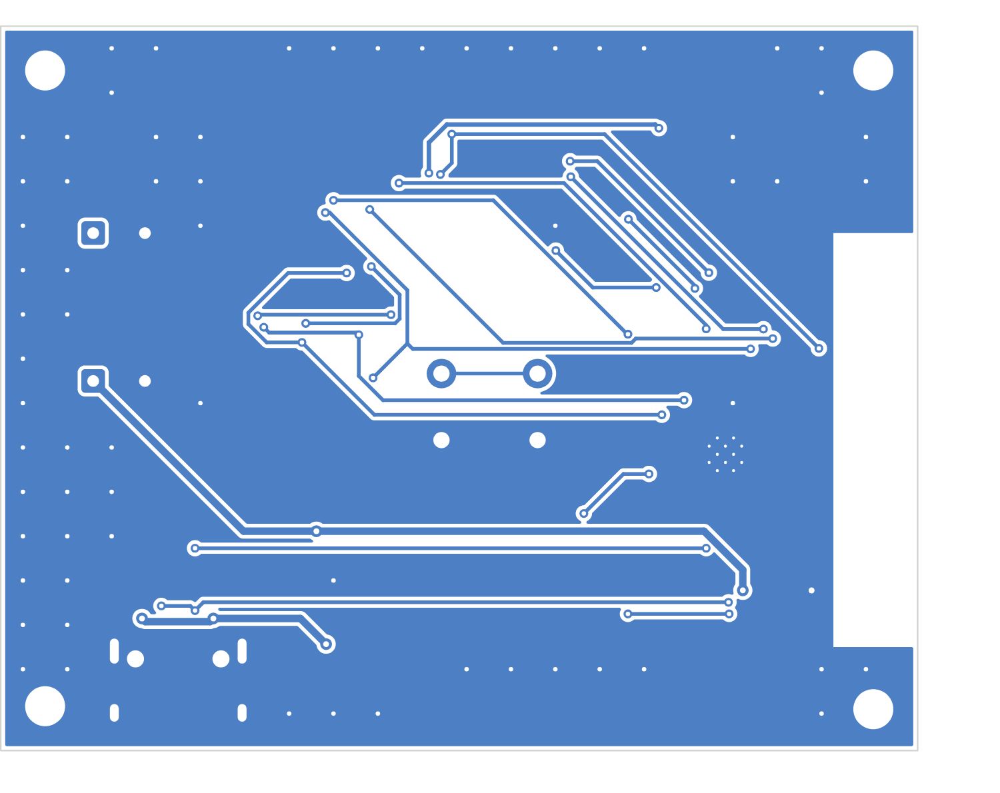
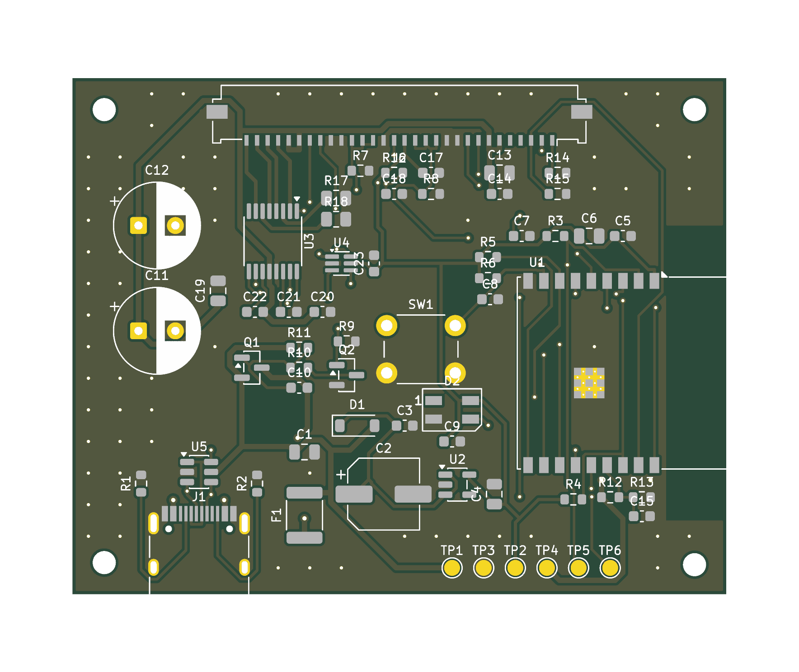

# Minai Printer — main board reference design (rev 0.1)

A complete first-pass design of the printer's one circuit board: schematic,
routed 2-layer board, manufacturing files and parts list.

**Status: designed and rule-checked in software only. Nothing has been built
or powered. Treat it as a starting point for an electronics engineer or
supplier to review, not as files to order 100 boards from.** The list of
things that must be checked first is in [Before ordering](#before-ordering).



| Top copper and silkscreen | Bottom copper |
|---|---|
|  |  |



## What is here

| Path | What it is |
|---|---|
| `kicad/minai-printer.kicad_pro` | KiCad 9 project. Open this to view or edit the schematic and board |
| `outputs/schematic.pdf` | Schematic, one A3 page |
| `outputs/board-top.pdf`, `board-bottom.pdf` | Board layers as PDF |
| `outputs/gerbers.zip` | Gerber and drill files for a PCB fabricator |
| `outputs/pick-and-place.csv` | Part positions for an assembly house |
| `outputs/bom.csv`, [`outputs/bom.md`](outputs/bom.md) | Parts list with search links for every line |
| `outputs/erc-report.txt`, `drc-report.txt` | KiCad rule-check reports |
| `gen/design.py` | The design itself: every part, pin, net and position, in one file |
| `gen/build.sh` | Regenerates everything above from `design.py` |

## The board at a glance

| Item | Value |
|---|---|
| Size | 62 × 49 mm, 2 layers, 1.6 mm, four M2 mounting holes |
| Parts | 53 placed parts, 31 BOM lines, all on the top side |
| Power in | USB-C, 5 V |
| Brain | ESP32-C3-WROOM-02 module (Wi-Fi, Bluetooth LE, native USB) |
| Print head drive | Direct from the module: data, clock, latch, two strobe groups |
| Head power | 5 V through a soft-started MOSFET switch, 2 × 1000 µF reservoir |
| Paper feed | DRV8833 dual H-bridge, 1 A current limit per coil |
| Sensing | Head thermistor, paper-out sensor, head-rail voltage |
| User interface | One button (also the firmware-flash button), one RGB LED |
| Mechanism connector | 30-pin, 1.0 mm pitch FPC |

### Pin map (ESP32-C3)

| GPIO | Signal | Notes |
|---|---|---|
| 0 | TM_ADC | Head thermistor, 30 kΩ divider |
| 1 | PS_ADC | Paper sensor phototransistor |
| 2 | HEAD_LAT | Latch, idle high (also satisfies the boot strap) |
| 3 | VH_SENSE | Head rail ÷ 2.47 |
| 4 | HEAD_CLK | Shift clock |
| 5 | VH_EN | High = head power and motor driver on. Pulled low |
| 6 | HEAD_DI | Shift data |
| 7 | HEAD_STB_A | Strobes 1–3. Pulled low |
| 8 | LED_DIN | RGB LED data, pulled high (boot strap) |
| 9 | BTN | Button to ground, pulled high (boot strap) |
| 10 | HEAD_STB_B | Strobes 4–6. Pulled low |
| 18 / 19 | USB D− / D+ | Flashing and USB serial |
| 20 / 21 | MOT_PH_A / MOT_PH_B | Motor phases; an inverter makes the complements |

All 13 usable pins are taken. That is why the motor uses two pins plus a
dual inverter instead of four pins.

## What was checked, and how

- **Schematic rule check (ERC): 0 errors.** 2 warnings, both about library
  bookkeeping (a custom symbol for the mechanism connector), not the circuit.
- **Board rule check (DRC): 0 errors, 0 unconnected nets, 0 shorts.** 31
  warnings, all silkscreen text overlapping pads or other text (cosmetic).
- **Schematic and board agree:** KiCad's parity check reports 0 differences,
  and both files are generated from the same netlist in `design.py`.

Not checked by anything: whether the circuit actually works, whether the
mechanism pinout is right, thermal behaviour, radio performance, EMC.

## Before ordering

These are known gaps, most important first.

1. **Mechanism pinout is not confirmed.** Connector J2 follows the Fujitsu
   FTP-628MCL101 layout. I could not open the datasheet from this session;
   pins 1–20, 23–24 and 27–30 match fragments of it found by web search;
   pins 21, 22 (ground) and 25, 26 (head power) are from memory. The
   compatible mechanism you actually buy (PT486F or similar) must be checked
   pin by pin against its own datasheet.
2. **Strobe polarity is assumed active-high.** R7 and R8 pull the strobes low
   so the head is off during reset. If the head is active-low, those two
   resistors must go to 3.3 V instead, or the head will burn at power-up.
3. **Motor coil pairing is assumed** to be pins 27–28 and 29–30. If the coils
   are paired differently the motor will not turn; this needs a board change,
   not firmware.
4. **FPC connector.** Fujitsu specifies Molex 52610-3071. The board uses the
   footprint for Molex 200528-0300 (same pitch and pin count) because that is
   what the KiCad library has. Contact side (top or bottom) and pin-1 end must
   match how the mechanism's cable reaches the board in the enclosure.
5. **Power tracks are thin.** The board was auto-routed. 5 V and head-power
   tracks are 0.5 mm; for 2 A pulses they should be 1 mm or wider, or copper
   pours. An engineer should hand-route the power path and review the rest.
6. **Motor is energised whenever head power is on.** Firmware must turn VH_EN
   off between print jobs or the motor sits at up to 1 A per coil.
7. **5 V supply behaviour is calculated, not measured**: soft-start timing
   (R10, R11, C10), droop during heavy black printing, and behaviour on weak
   USB ports all need bench testing.
8. **Mechanical layout came first, enclosure second.** Board size and
   connector, button and LED positions were chosen for routing. The
   [enclosure](enclosure/README.md) was then drawn around them.
9. **Module lifecycle.** Confirm with the supplier which ESP32-C3-WROOM-02
   variant is current before buying.
10. **Silkscreen** labels overlap in places and need tidying.

## Parts and links

I could not open supplier sites from this session, so links are of two
kinds: pages that came up in web search (marked *found*), and search links
built from the part number (marked *search*), which open a results page.

### The print mechanism (not on the board)

| What | Link |
|---|---|
| Fujitsu FTP-628MCL101/103 datasheet, maker's site (*found*) | https://www.fcl-components.com/downloads/MICRO/fcai/thermal-printers/ftp-628mcl101_103-72.pdf |
| Same datasheet, Mouser copy (*found*) | https://www.mouser.com/datasheet/2/164/ftp_628mcl101_103-1713842.pdf |
| FTP-628MCL101#50 full specification (*found*) | https://www.printertec.com.br/arquivos_download/FTP-628MCL101_50.pdf |
| Compatible mechanism, TP628 series (*found*) | https://www.oposprinter.com/tp628-thermal-printer-mechanism-series-compatible-with-fujitsu-ftp-628mcl101-product/ |
| Compatible mechanism listing, Made-in-China (*found*) | https://xiamenjrp.en.made-in-china.com/product/qbQJYTDrVUls/China-FTP-628mcl101.html |
| PT486F-101 retail listing (*found*) | https://www.shreyanspos.com/products/pt486f-101-58mm-thermal-printer-mechanism |
| PT486F price listing, $3.90–4.50 (*found*) | https://china.org.ru/product/1600620307316 |
| Alibaba (*search*) | https://www.alibaba.com/trade/search?SearchText=PT486F+thermal+printer+mechanism |

Figures from those sources: 384 dots, 176 Ω per dot, head and motor
4.2–8.5 V, logic 3.3 V or 5 V, thermistor 30 kΩ at 25 °C.

### Main parts on the board

| Ref | Part | Maker page | Buy (*search*) |
|---|---|---|---|
| U1 | ESP32-C3-WROOM-02-N4 Wi-Fi/BLE module | [Espressif](https://www.espressif.com/en/products/modules/esp32-c3) | [LCSC](https://www.lcsc.com/search?q=ESP32-C3-WROOM-02-N4) · [DigiKey](https://www.digikey.com/en/products/result?keywords=ESP32-C3-WROOM-02-N4) |
| U3 | DRV8833PWR motor driver | [TI](https://www.ti.com/product/DRV8833) | [LCSC](https://www.lcsc.com/search?q=DRV8833PWR) · [DigiKey](https://www.digikey.com/en/products/result?keywords=DRV8833PWR) |
| U2 | AP2112K-3.3 regulator | [Diodes Inc.](https://www.diodes.com/part/view/AP2112) | [LCSC](https://www.lcsc.com/search?q=AP2112K-3.3TRG1) · [DigiKey](https://www.digikey.com/en/products/result?keywords=AP2112K-3.3TRG1) |
| U4 | 74LVC2G04 dual inverter | [Nexperia](https://www.nexperia.com/product/74LVC2G04GW) | [LCSC](https://www.lcsc.com/search?q=74LVC2G04GW) · [DigiKey](https://www.digikey.com/en/products/result?keywords=74LVC2G04GW) |
| U5 | USBLC6-2SC6 USB protection | [ST](https://www.st.com/en/protection-devices/usblc6-2.html) | [LCSC](https://www.lcsc.com/search?q=USBLC6-2SC6) · [DigiKey](https://www.digikey.com/en/products/result?keywords=USBLC6-2SC6) |
| Q1 | AO3401A P-channel MOSFET | | [LCSC](https://www.lcsc.com/search?q=AO3401A) · [DigiKey](https://www.digikey.com/en/products/result?keywords=AO3401A) |
| Q2 | 2N7002 N-channel MOSFET | | [LCSC](https://www.lcsc.com/search?q=2N7002) · [DigiKey](https://www.digikey.com/en/products/result?keywords=2N7002) |
| D2 | SK6812MINI RGB LED | | [LCSC](https://www.lcsc.com/search?q=SK6812MINI) · [DigiKey](https://www.digikey.com/en/products/result?keywords=SK6812MINI) |
| J1 | HRO TYPE-C-31-M-12 USB-C socket | | [LCSC](https://www.lcsc.com/search?q=TYPE-C-31-M-12) |
| J2 | Molex 200528-0300 FPC connector | | [LCSC](https://www.lcsc.com/search?q=200528-0300) · [DigiKey](https://www.digikey.com/en/products/result?keywords=2005280300) |

Every other line (resistors, capacitors, fuse, diode, switch) is in
[`outputs/bom.md`](outputs/bom.md) with the same kind of search links.

## Rebuilding

`gen/design.py` is the source. To change the circuit or move a part, edit it
and run:

```bash
FREEROUTING_JAR=/path/to/freerouting.jar hardware/gen/build.sh
```

Add `--route` to re-place and re-route the board. Routing is automatic and
gives a different result every run; some runs leave a net unrouted or
create a short, so check `outputs/drc-report.txt` each time. Editing the
board by hand in KiCad is fine too, but a later `--route` run will discard
those edits.

Requirements: Docker with the `kicad/kicad:9.0` image, Java 17 or newer, and
the Freerouting jar (tested with v2.0.1).
