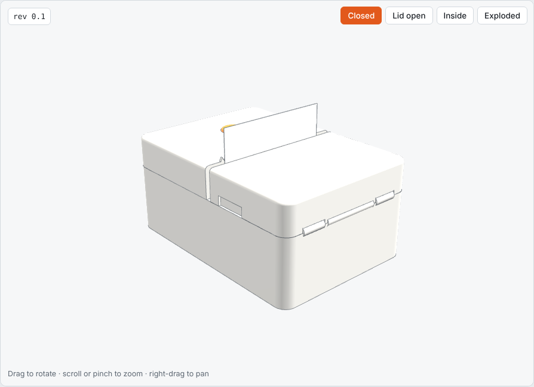
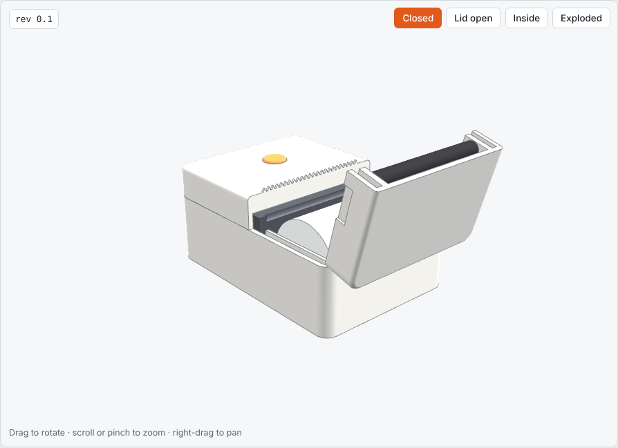
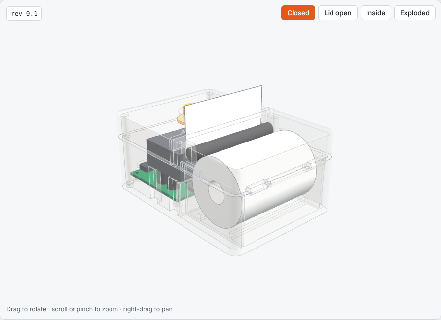
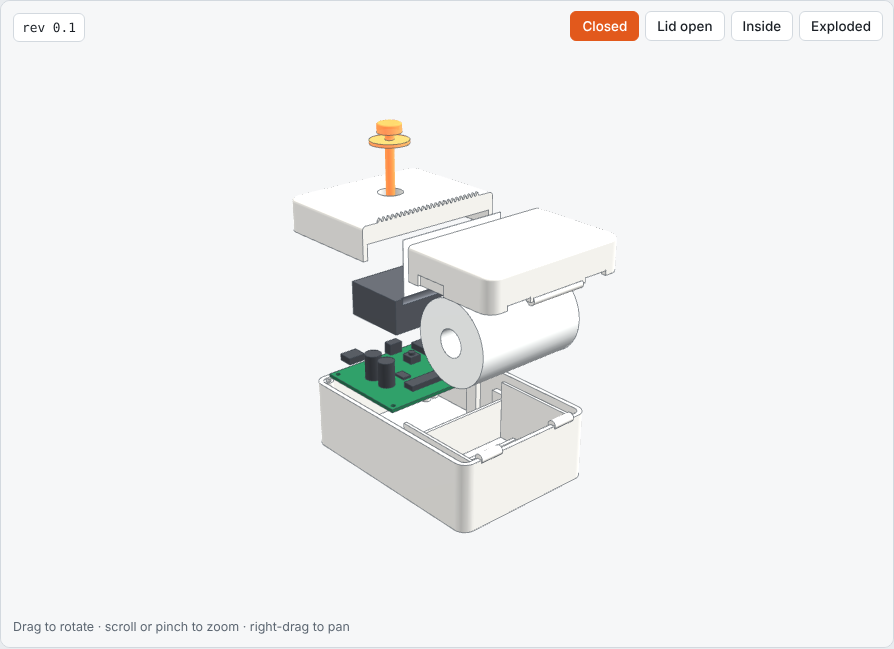

# Minai Printer — enclosure (rev 0.1)

A first-pass enclosure designed around the reference main board, a 58 mm
paper roll and a stand-in block for the print mechanism.

**Status: a concept model. Nothing has been printed or fitted.** The print
mechanism is an assumed 70 × 31 × 16 mm block, not the real part, so
everything that touches it (mounting posts, paper slot, platen roller
position, lid latch) has to be redrawn once you have the mechanism's drawing
or a sample in hand.

| Closed | Lid open |
|---|---|
|  |  |
| **Inside** | **Pulled apart** |
|  |  |

To turn it around yourself, open `viewer.html` in a browser.

## The design

| Item | Value |
|---|---|
| Outside size | 76.8 × 109.3 × 50 mm (width × depth × height) |
| Printed parts | 4: base, lid, rear cover, button |
| Wall thickness | 2.4 mm |
| Plastic volume | about 92 cm³ in total |
| Paper | 58 mm roll, up to 40 mm diameter, drop-in |
| Fasteners | 4 M2 self-tapping screws for the board, 2 for the rear cover |

- **Layout.** The paper roll sits in a bay at the front. The board lies flat
  at the back with the mechanism above its front edge. Paper comes up between
  the lid and the rear cover and exits through a 3 mm slot on top.
- **Lid.** Hinged at the front edge and carrying the platen roller at its
  rear edge, so opening the lid lifts the roller off the print head and the
  roll can be dropped in.
- **Tear bar.** A serrated strip moulded into the rear cover along the slot.
- **Button.** One translucent orange button on the rear cover, directly above
  the switch on the board. The board's RGB LED sits 6.5 mm from the switch
  and lights the button from below, so there is no separate light window.
- **USB-C.** An opening in the rear wall lined up with the socket on the board.

## Files

| Path | What it is |
|---|---|
| `enclosure.py` | The parametric model (CadQuery). All dimensions are at the top |
| `out/*.step` | One STEP file per printed part, for a supplier or CAD package |
| `out/*.stl` | One STL per printed part, for 3D printing |
| `out/minai-printer-assembly.step` | Everything together, including the stand-in parts |
| `viewer.html` | Interactive 3D view |

Rebuild after changing a dimension:

```bash
pip install cadquery
```

```bash
python3 hardware/enclosure/enclosure.py
```

```bash
python3 hardware/enclosure/build_viewer.py
```

## Known gaps

1. **Mechanism geometry is assumed.** See the status note above.
2. **Depth is 109 mm**, over the 100 mm target in the spec. The extra comes
   from the mechanism overhanging the front of the board; a board laid out
   for this enclosure could recover it.
3. **No lid latch or hinge pin detail.** The hinge is drawn as plain
   knuckles; it needs a pin or snap design and a catch to hold the lid shut
   against the platen spring force.
4. **No snap fits, ribs, draft angles or screw-boss detailing** for
   moulding. It is fine for 3D printing a first sample, not for tooling.
5. **Button travel and light spread are untested.** The 32 mm stem needs a
   guide, and the LED may need a small light guide to light the cap evenly.
6. **Antenna.** The Wi-Fi antenna sits against the right-hand wall, clear of
   the screws, but range inside the closed case is untested.
7. **No feet, vents or label recess yet.**
